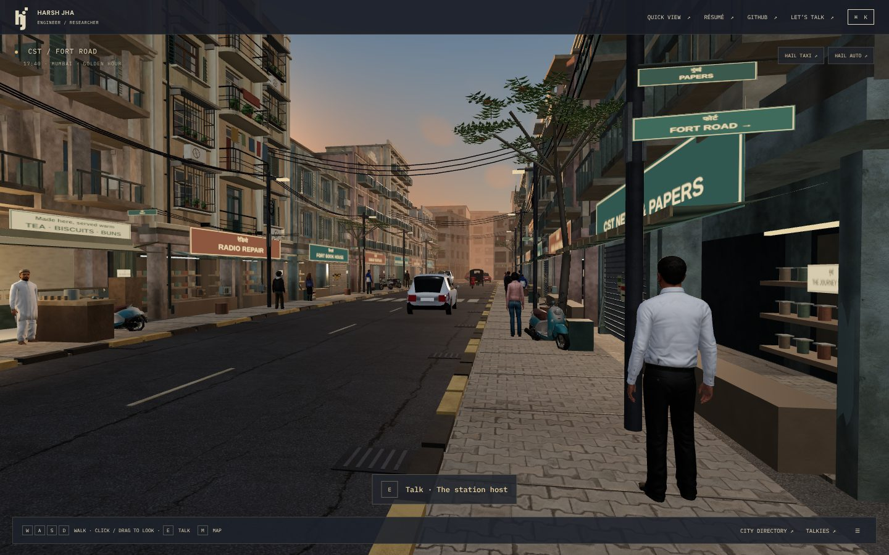
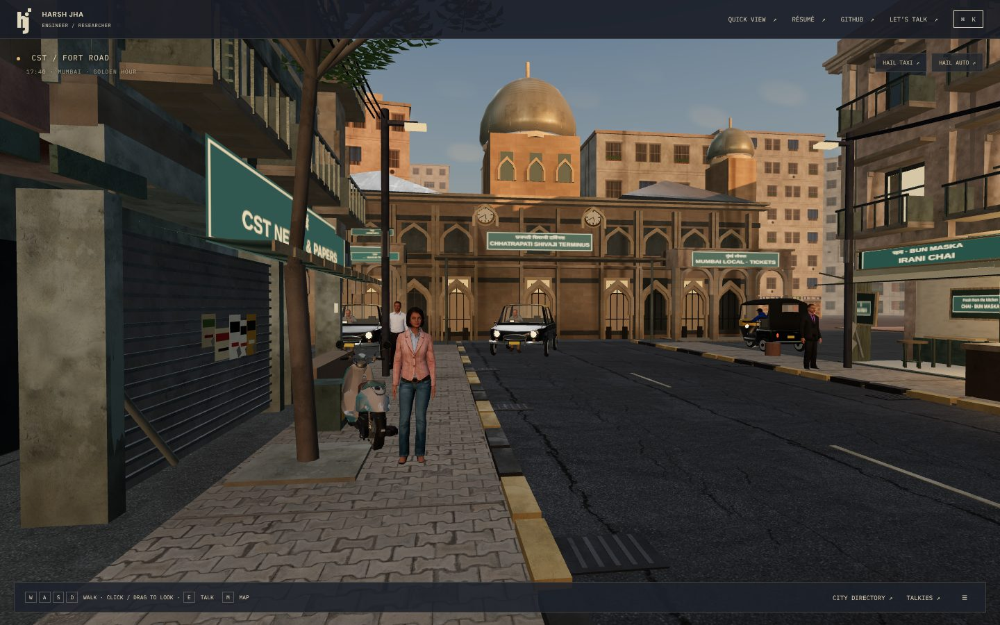
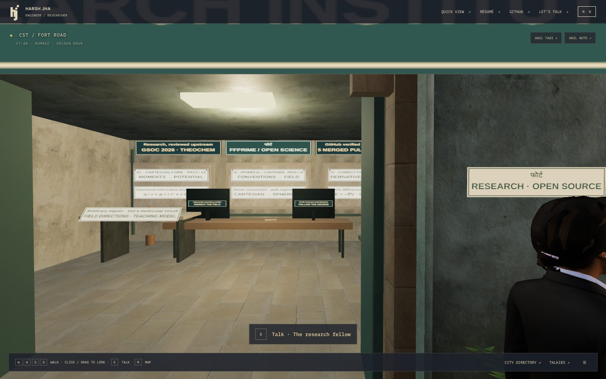
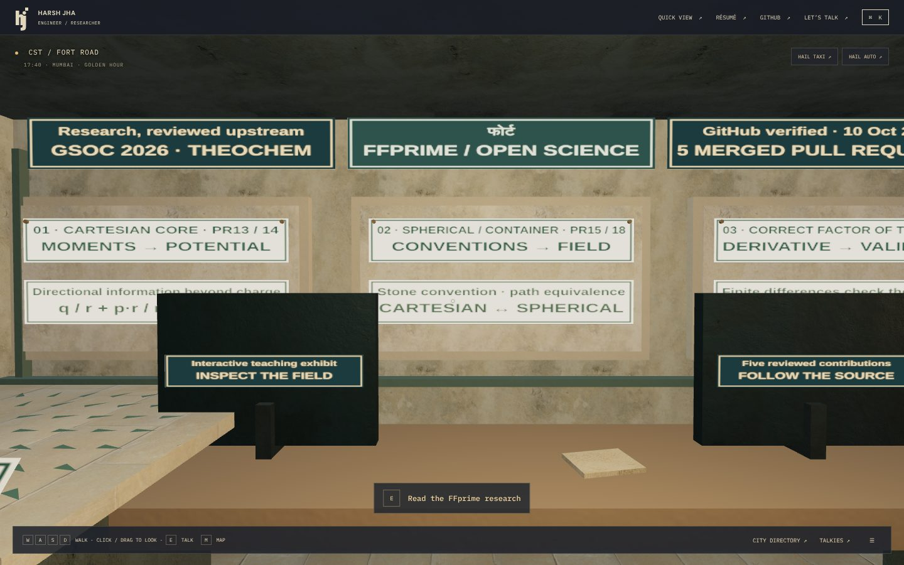
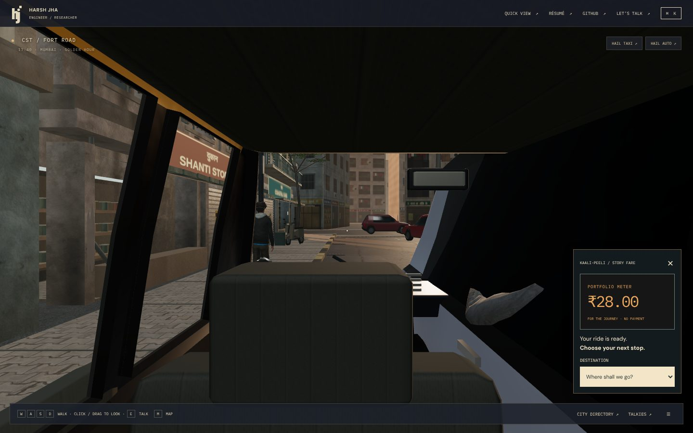
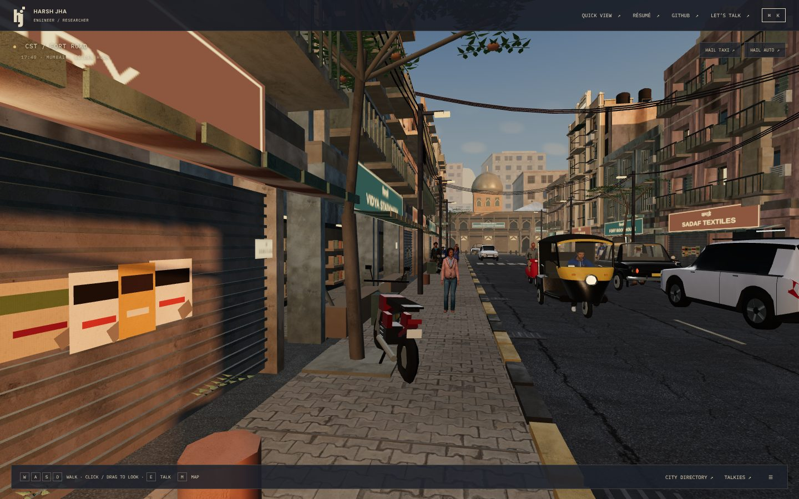
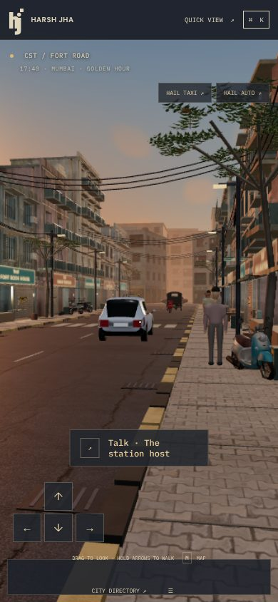
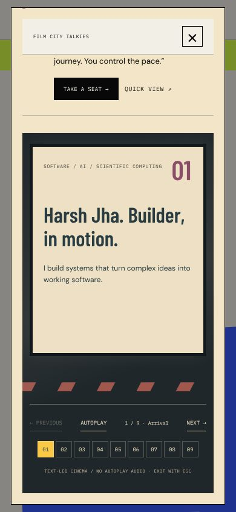

# Gamified portfolio baseline

Phase 0 of the gamified open-world brief: what the portfolio actually did before this pass, measured on `feature/cst-fort-rendering-optimization` at `7702bd3` (PRs #1 to #11 merged), 2026-10-15.

## How it was measured

| Step | Command | Result |
|---|---|---|
| Install | `npm ci` | OK (Node 22, npm 10) |
| Typecheck | `npm run typecheck` | Pass |
| Unit tests | `npm test` | 24 files, **202 passed**, 15.0 s |
| Production build | `npx vite build` | Pass in 6.2 s. Chunks over 500 kB: `WorldEngine` 549 kB (178 kB gzip), `three` 589 kB, app `index` 710 kB, Recast WASM 726 kB |
| Browser exploration | `scripts/capture-art-sprint-2.mjs` against a worktree of the base on port 5175 | 16 poses at 1440×900, taxi and auto boarding, a 390 px phone and the WebGL-off theatre. No page errors or console errors |
| Payload | `du -sh public` | 19 MB, of which 16 MB models and 3.4 MB surfaces |

The cloud container renders with **SwiftShader** (software WebGL). Frame rates from it (0.2 fps while moving) say nothing about a real GPU, so this document records counts (draws, triangles, textures, shader programs), not FPS. Reduced motion renders on demand, so static poses read `idle`.

## Feature matrix

Status uses the brief's vocabulary. "Verified" means it was exercised in the browser or by an existing test in this run, not just found in code.

| Feature | Status | Evidence and notes |
|---|---|---|
| First-person walking (WASD, Shift, mouse/drag look, comma/period turn) | Implemented and verified | `WorldEngine.frame`, fixed 1/60 s cannon-es step; `tests/city.spec.ts` keyboard-look test |
| Collision with walls, kerbs, the research doorway | Implemented and verified | `tests/street.test.ts` walks a full-height body into the Fort room |
| R to recover | Implemented | Returns to CST spawn from anywhere; there is no "last safe spot" recovery |
| E / click to interact | Implemented, imprecise | Nearest target inside a 66° horizontal cone, 3.8 m. With several exhibits in one room the prompt follows distance, not gaze. Tested every frame with a ray per candidate |
| Interaction targets in CST–Fort | Partially implemented | Five: station host, research fellow, one FFprime terminal, taxi stand, auto stand. The Fort room's two screens, three wall panels and field table were decorative |
| Guides in every district | Implemented, same pattern everywhere | Every guide opens the same district modal layout; no in-world guided tour |
| Taxi / auto loop (hail → approach → board → choose → ride → meter → arrive → exit) | Implemented and verified | `RideMeter`, `transit.ts`; `tests/city.spec.ts` rides to Fort and back. Cancel and skip work. The meter is labelled as a game meter, not a tariff |
| Cross-district rides | Implemented and verified | Exit leg, cut, arrival leg (`cityRideLegs`); all nine stops reachable |
| Road graph | Partially implemented | Authored per-district lane polylines, not a graph; no pathfinding, by design (one street per district) |
| Ambient traffic | Implemented | Modelled cars, buses and bikes with three LODs; `scripts/probe-traffic.mjs` reported all zones clean in PR #9 |
| Traffic signals | Partially implemented | Pedestrian green phases (`pedestrianGreen`) gate walkers; vehicles do not stop for lights |
| Player-driven vehicle | Missing / dead code | `src/game/Vehicle/Vehicle.ts` and `src/game/World/Campus.ts` are not imported anywhere |
| NPCs | Implemented | 41 Microsoft Rocketbox (MIT) characters, Recast crowd on the CST street, district crowds; semi-realistic, Western clothing except the vendor |
| City map / fast travel | Implemented and verified | `CityMap`: nine stops, ride or jump |
| Recruiter Quick View | Implemented and verified | Loads without the 3D chunk; `#quick` |
| WebGL fallback | Implemented and verified | `?webgl=off` opens Quick View and HTML district guides |
| Film City theatre | Implemented, controls incomplete | Previous, next, autoplay and scene picker. No restart, no skip-to-end, no exit button, no keyboard shortcuts |
| Fort research content | Implemented, all in one modal | Field map, chapters, coordinate workstation and PR list are stacked in one district dialog |
| Powai labs, Andheri shops | Implemented and verified | PRs #6, #8, #10, #11 |
| BKC, Dadar, Worli, Juhu interactions | Placeholder-level | Text and lists inside the guide modal; no district-specific mechanic |
| Exploration journal | Missing | |
| Achievements, quests | Missing | |
| Onboarding / orientation | Missing | The editorial intro has Enter and Quick View only |
| Station board as navigation | Missing | A single "FORT ROAD →" blade sign |
| Wayfinding to a chosen destination | Missing | |
| Sound | Implemented | Original WebAudio synthesiser, off by default |
| Quality presets | Implemented | High / Medium / Low plus adaptive render scale |
| Reduced motion | Implemented and verified | Disables bob and moving scenery; rides arrive directly |
| Persistence | Minimal | Only the `hj-motion` preference |
| README | Out of date | Still says the other seven districts are not built |

## Render counts at matched poses (Medium, 1440×900)

Debug-overlay totals (main pass plus any shadow refresh in that frame), from `screenshots/gamified-baseline/measurements.json`:

| Pose | Draws | Triangles | Textures | Programs |
|---|---|---|---|---|
| spawn (first frame, shadow refresh) | 159 | 404,322 | 40 | 36 |
| station | 68 | 183,811 | 41 | 36 |
| junction | 77 | 214,740 | 46 | 36 |
| fort (doorway) | 33 | 143,500 | 46 | 36 |
| fort-room | 33 | 134,956 | 46 | 36 |
| return | 106 | 222,381 | 46 | 36 |
| taxi (boarded) | 52 | 185,168 | 47 | 36 |
| 390 px phone (Low) | 71 | 190,466 | 19 | 21 |

Texture and program counts were already over the 32 / 26 review ceilings before this pass, all from the Rocketbox cast (documented in `docs/STREET_CAST.md`).

## Screenshots

| | |
|---|---|
|  |  |
|  |  |
|  |  |
|  |  |

## What the baseline told us to do first

1. The Fort room looked like an empty office: one table, two black boxes and decorative panels that could not be used. It is the flagship research space, so it gets real exhibits first.
2. Interaction picked the nearest object, which breaks down as soon as a room has more than one thing in it. Targeting has to follow the gaze.
3. Nothing told a new visitor what to do, and nothing remembered what they had seen. Orientation, a journal and achievements are cheap and change how the whole city feels.
4. The station had no navigation. The brief's departure board is the natural index of the portfolio.
