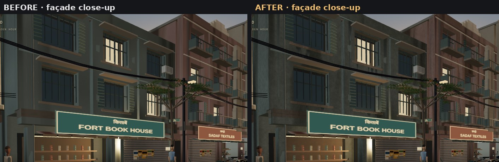
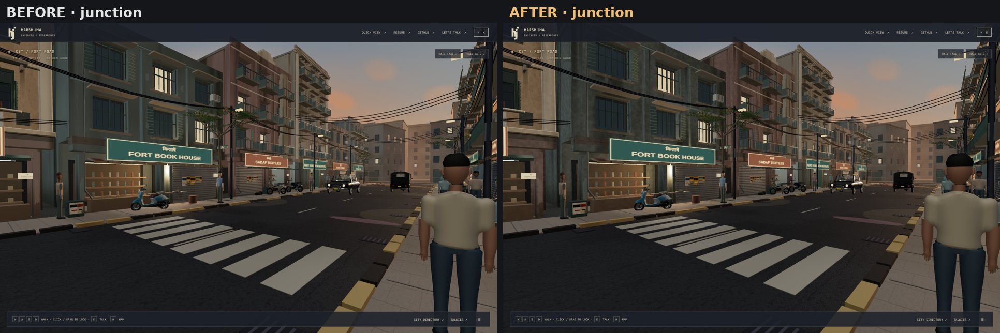
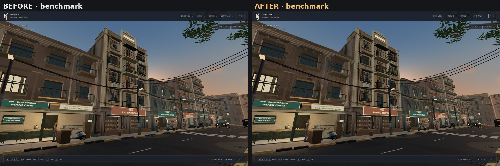
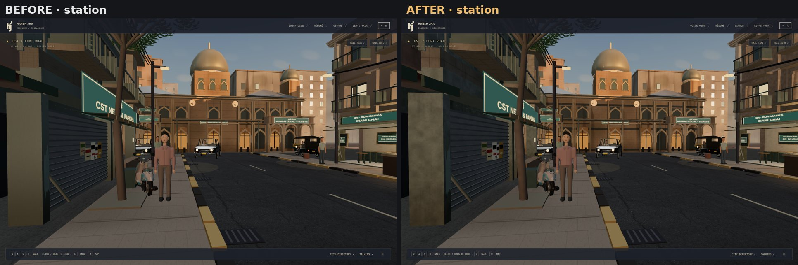
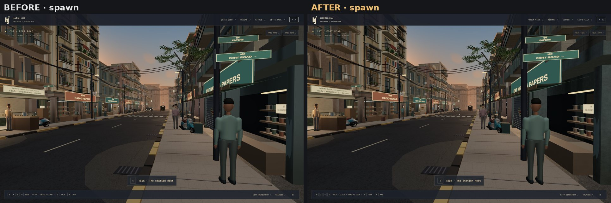
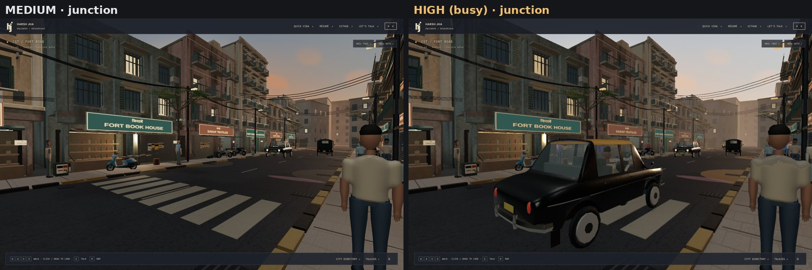
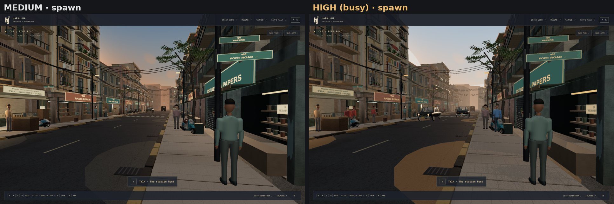
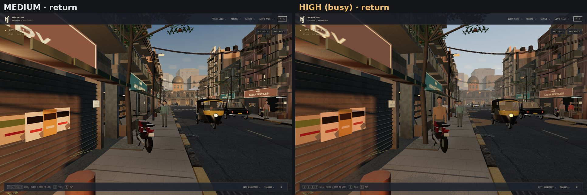

# Street assets pass: authored and scanned assets in place of code-made ones

This pass follows Harsh's request of 12 October 2026: "make the environment buildings cars and everything around realistic like the npc characters". The NPC thread got that realism by bringing in authored assets (Microsoft Rocketbox). This pass tries the same for the environment.

It works on branch `claude/mumbai-visual-overhaul-wsa2hm` (PR #3), on top of the realism pass in [STREET_REALISM_PASS.md](STREET_REALISM_PASS.md).

## What could be sourced

| Need | Reachable, openly licensed? | Outcome |
| --- | --- | --- |
| Scanned plaster, concrete, brick for façades | **No.** Poly Haven, ambientCG and texture sites are refused by this environment's network policy, and GitHub mirrors only hold scraps (one brick set, one ground set). | **BLOCKED.** An original generated cement-render set stands in (see Façade surfaces) |
| Mumbai buildings (Deco walk-ups, chawls) as models | **No.** Nothing suitable and licensed is reachable. | **BLOCKED** |
| Premier Padmini taxi, Bajaj auto-rickshaw, BEST bus | **No.** These exist mostly on Sketchfab, which is refused and needs a signed-in download. GitHub holds only sports cars, mostly under non-commercial licences. | Taxi and auto: **modelled here instead** (original, see below). Bus: **BLOCKED** |
| Road asphalt | **Yes.** Poly Haven "Asphalt 02" (CC0) is mirrored in the Khronos glTF sample repository. | **Done** |
| A realistic scooter | **Yes.** "Vino" by minghauLoh (CC-BY 4.0), mirrored in `gkjohnson/3d-demo-data`. It is close to the Yamaha Fascino sold in India. | **Done** |
| A real golden-hour sky for reflections | **Yes.** Poly Haven "Venice Sunset" (CC0), mirrored in three.js. | **Tried and rejected** (see below) |

To unblock the rest:
- **Scanned textures:** add `polyhaven.com`, `dl.polyhaven.org`, `api.polyhaven.com` and `ambientcg.com` to the project's cloud-environment network allowlist.
- **Vehicle models:** Harsh downloads the Sketchfab models himself and adds them to the project. Their licences are then checked before use.

## Visual review

These are matched captures: SwiftShader, 1440×900, Medium preset, reduced motion. The before images are PR #3's head at `9d6a39a`; the after images are this branch. The images are in [`screenshots/street-assets/`](screenshots/street-assets/).


**Parked scooters: done, authored asset.**
- The five parked scooters are now the authored Vino model, replacing the boxy code-built scooter. You can see its real curved legshield, apron, seat, mirrors, chrome, spoked wheels and two-tone paint.
- To fit the street's budgets, it was decimated from 95,583 to 4,376 triangles in Blender. Each material was decimated separately, so paint, seat and tyre boundaries stay where the artist put them.
- Colour, roughness and metalness were then re-sampled from the artist's textures into vertex data. The scooter therefore draws with the street's shared baked material: **no textures and no new shader program**.
- The beginner's-licence decal was removed.
- Small variations in finish give each parked scooter a slightly different paint tone.

**Limits:**
- At 4.4k triangles, the wheels and fine parts are faceted up close. Colour edges zig-zag slightly where a paint boundary crosses a large triangle.
- The scooter is shown only on foot, within 24 m along the street. While riding, the earlier code-built scooters stand in for it, because ride frames have no triangle headroom.
- Those code-built scooters are also what cast the (cached) shadows, so the shadow outline is approximate.
- Motorcycles are still code-built. No suitably licensed realistic motorcycle was reachable.


**Road asphalt: done, scanned asset.**
- The road's colour and roughness maps are now a photographic scan with aggregate, patches and real cracks. They replace the generated noise map one for one, so the **texture count is unchanged**.
- The scan is mapped in world metres, with one 3 m tile, through the shared weathering shader. Wide and narrow road pieces therefore share one scale instead of stretching.
- The colour is tone-matched to the old map in linear light, so the measured road brightness is unchanged (mean pixel 28.2 vs 27.9 at the junction).
- The normal map is **derived** from the scan's luminance, because the source has none. It is labelled as derived in `public/surfaces/provenance.json`.
- **Limit:** at 3 m the main crack repeats along the road. Up close this reads as a continuous crack line. At the junction you can see the repetition across the width.


**Golden-hour sky as image-based light: tried, rejected.**
- The CC0 "Venice Sunset" HDRI was clamped so it would not act as a second sun, turned to the scene's sun azimuth, and used in place of the neutral RoomEnvironment probe.
- At matched exposure, it made the shaded façades darker and bluer. That undid the station and street readability from the realism pass.
- It is not in this branch. The script and findings are kept out of the repository.


**Taxi and auto bodies: done, original models (not third-party assets).**
- With no licensed vehicle reachable, the Padmini "kaali-peeli" taxi and the Bajaj-style auto were modelled as code in Blender (`scripts/vehicles/build_taxi.py`, `build_auto.py`).
- The taxi has a lofted body with real wheel arches, door seams, a chrome side strip, a curved greenhouse with glazed openings, a black body and yellow roof, chrome bumpers with overriders, an oval grille, ringed headlamps, wing mirrors, plates and mud flaps.
- The auto has a curved front cowl with a single headlamp, a canvas canopy with a rear window, steel pillars, a fork and mudguard, a floor, and a rear body with wheel arches.
- Colour, roughness, metalness and baked ambient occlusion are stored in vertex data. Each body draws with the street's shared baked material, so it adds **no textures and no shader program**. Glass and lamps reuse the vehicle's own materials.
- They replace only the code-built exterior; the cabin, driver and wheels are unchanged. Every taxi and auto uses them, including ride vehicles and traffic. If loading fails, the code-built exterior stays.
- **Cost:** each body has fewer triangles than the exterior it replaces: taxi 3,648 vs 3,728, auto 1,558 vs 1,624. A test enforces this.
- **Limits:** the wheels are still the code-built ones. The bodies are original approximations from reference knowledge, not measured replicas. There is no plate lettering, because the bodies carry no textures.

**Unchanged in that pass:** buildings, the CST station, the bus, shopfronts and props other than scooters and vehicles. The façade work below came next.

### Façade surfaces (13 October 2026)

Harsh asked for the buildings to look realistic. GitHub was searched for an open library like Rocketbox, this time for buildings. About 20 repositories were checked, among them pmndrs market, Babylon, three.js, Khronos, AMD Cauldron, CARLA, Godot, Bevy, O3DE and streets-gl. None had realistic, cleanly licensed Mumbai buildings or façade scans. The closest were streets-gl's MIT façade tiles, but they are clean grey European brick and block at 512 px. Scanned textures stay **BLOCKED** on the allowlist above. This pass makes the walls themselves read as aged render, without new textures or programs.



- **Cement-render maps, original:** `scripts/generate-plaster-maps.py` replaces the 256 px noise plaster set (colour, roughness, normal) with a tileable 1,024 px study of painted cement render. It has float-trowel undulation, sand grain, aggregate pits, hairline cracks, patched repairs, and flaking paint over grey cement, with dirt held in the cracks. It is generated from seeded noise; no photographs or third-party input. It replaces three textures one for one, so the texture count is unchanged.
- **Wall maps in real metres:** plaster and stone were mapped on each box's own UVs, so every wall stretched them differently and the detail washed out. They now tile in world metres on each face's plane: plaster every 2 m, stone courses about 30 cm apart. This uses the same shared shader patch as the asphalt (`uWallUv`), so the program count is unchanged.
- **Shader ageing:** the same patch adds procedural plaster relief to the shading normal within 25 m, plus fine grain, patchy repaint and long monsoon tide marks. It uses seven value-noise lookups per pixel. It applies to every lit street material by uniform strength; people, vehicles and glass stay at zero.
- **Rain run-off:** tapered streaks hang under every window sill and run down the solid piers from each parapet. They are dark where water leaves the ledge and fade toward the wall colour. They merge into the existing damp-patina mesh, so they add **no draw call**. They replace the small per-storey pier patches, which cost a similar number of triangles, so every frame now submits about 54 fewer triangles than before.
- **Station:** grey-blue basalt courses band the buff sandstone front, as on the Indo-Gothic original, and its stone now shows coursing at a true scale.






**Limits:** these are still generated surfaces, not photographs of Mumbai walls. The streaks follow the shared window grid, so Radio House (authored separately) has none. Geometry, colours and signage are unchanged. Real scans would replace the generated maps one for one once the sites are allowed.

### Busier street on the High preset (13 October 2026)

Harsh asked for "a GTA kind of feel" because the street "looks like krunker". On the budget question, he chose to add a **High preset**: Medium keeps today's budgets, and High may spend more on crowds and traffic.

- **High only:** 16 more walkers on the pavements, with their own crowd agents. Seven more people stand at shop counters and the chai stall. Three more vehicles join the road loop (two taxis, one auto), spaced between the existing three.
- **Medium and Low:** the extra people and cars are hidden and parked, and out of the crowd simulation. Medium captures are identical to before, to the triangle (spawn 80 / 218,091; junction 71 / 204,718; return 103 / 213,657).
- **Painted and metal parts** on every preset now use the same cement-render maps as the walls, in world metres, instead of flat colour. They use the same textures and program, so no budget changes.





**High preset budget (new, set with Harsh's approval):** 300 draws, 600,000 triangles, 64 textures and 60 programs. High already cost about twice Medium before this pass, because its SSAO renders a normal pass of the whole scene. It measured 142–202 draws, 408,851–435,105 triangles, 35–40 textures and 53–54 programs. The extra crowd and traffic are drawn twice for the same reason.

| Review pose (High) | Before | With crowd and traffic |
| --- | --- | --- |
| spawn | 159 / 435,105 / 35 / 53 | 252 / 552,833 / 53 / 53 |
| junction | 142 / 408,851 / 40 / 53 | 212 / 503,003 / 63 / 53 |
| return | 202 / 425,937 / 40 / 54 | 276 / 533,505 / 63 / 54 |

Each skinned person adds one bone texture, which is why textures rise with the crowd.

**Limits:** the extra people are the same procedural figures as the rest of the street; the Rocketbox cast is on its own branch. The road is one short loop, so "busy" here means more cars on it, not more lanes or streets. That belongs to the city-expansion work.

## Performance

The static review budget is 110 draws, 230,000 triangles, 32 textures and 26 programs. **No budget was raised.**

| Pose | Before draws / tris / textures / programs | After |
| --- | --- | --- |
| spawn | 79 / 210,179 / 27 / 26 | 82 / 218,567 / 28 / 26 |
| junction | 69 / 201,130 / 32 / 26 | 71 / 204,778 / 32 / 26 |
| station-front | 49 / 140,324 / 32 / 26 | 49 / 139,596 / 32 / 26 |
| hero-wide | 37 / 171,153 / 32 / 26 | 39 / 176,621 / 32 / 26 |
| return | 102 / 214,035 / 28 / 26 | 103 / 213,671 / 32 / 26 |
| scooter (new pose) | 58 / 169,746 / 28 / 26 | 60 / 174,122 / 28 / 26 |

Software benchmark (`scripts/benchmark-gpu.mjs`, SwiftShader, 1920×1080, short rides): maximum cached-frame submissions.

| Scenario | PR #3 head | This branch |
| --- | --- | --- |
| walking | 214,155 / 84 draws | 222,543 / 87 draws |
| taxi ride | 220,455 / 93 | 220,455 / 94 |
| auto ride | 226,969 / 107 | 226,241 / 108 |
| fort | 144,112 / 30 | 144,112 / 31 |

Peak textures stay at 28–32 and peak programs at 26 in every scenario.

After the taxi and auto bodies (same benchmark settings):

| Scenario | Before bodies | With modelled bodies |
| --- | --- | --- |
| walking | 222,543 / 87 draws | 222,709 / 87 draws |
| taxi ride | 220,455 / 94 | 220,673 / 95 |
| auto ride | 226,241 / 108 | 226,433 / 109 |
| fort | 144,112 / 31 | 144,112 / 31 |

Textures and programs are unchanged (28–32, 26).

After the façade surfaces (13 October; same benchmark settings):

| Scenario | With modelled bodies | With façade surfaces |
| --- | --- | --- |
| walking | 222,709 / 87 draws | 222,873 / 87 draws |
| taxi ride | 220,673 / 95 | 220,837 / 95 |
| auto ride | 226,433 / 109 | **230,821** / 109 |
| fort | 144,112 / 31 | 144,276 / 31 |

Textures and programs are unchanged (28–32, 26). That run included a few more streaks than the final version, so it was 164 triangles over the earlier numbers. The streaks were then trimmed; matched review captures now read 54 triangles *below* the earlier ones at every pose (spawn 218,091 vs 218,145; junction 204,718 vs 204,772; station-front 181,591 vs 181,645; return 213,657 vs 213,711).

**Recorded honestly: the auto ride is over the ceiling at the sampled moment.** The short software ride captures only one or two cached frames. Each lands wherever the auto has reached by then, and the heavier wall shading slows SwiftShader frames (walking p50 5.5 s → 7.4 s). The first façade run read 231,541 and the second 230,821. The façade pass changes any frame by at most +164 triangles, and now by −54, so the same frame on the earlier code would also be above 230,000. **The overrun is a pre-existing peak on the auto route that this sampling exposed, not new geometry.** It needs fixing before merge, by trimming what the ride sees around that point; this pass does not raise the ceiling.

Download size: the plaster maps grew from 209 KB to 2.2 MB (1,024 px in place of 256 px).

**Recorded honestly:**
- The first version of the bodies (taxi 4,680 triangles) pushed the auto ride to 230,393 triangles, over the ceiling. Both bodies were then trimmed below the exteriors they replace.
- Swapping in the bodies at first compiled one extra shadow program (27). The cause was a front-side textured shadow caster: the seat fabric. It now casts double-sided shadows and shares the existing program.

The benchmark and capture scripts now wait for the street's assets (surfaces, scooters and vehicle bodies) before measuring.

**First run, recorded honestly.** At first the stand-in scooters were one always-drawn batch, and the auto ride peaked at 231,193 triangles, over the ceiling. They are now merged in street order and trimmed per frame with a draw range, which gives the 226,241 above.

SwiftShader frame intervals are slow and noisy; walking p50 is 5.5 s here against 5.5 s on PR #3's head.

Download size: the scooter GLB is 510 KB. The asphalt maps grew from 260 KB to 1.6 MB because they are 512 px scans in place of 256 px noise.

## Tests and build

- `npx tsc --noEmit`: clean.
- `npx vitest run`: 99 pass (95 before the façade pass; it added the wall-mapping and run-off tests, and the High pass added dense-traffic and dense-street tests). The new tests in `tests/street-assets.test.ts` cover:
  - scan pins and licences;
  - the world-UV patch keeping one program key;
  - the scooter's hash, credit and lack of textures;
  - the re-packed attributes, size and cost;
  - the stand-in/shadow switching;
  - the taxi and auto bodies' hashes, attributes, fit to the wheels and roof, and their triangle cost against the code-built exterior.
- **Correction to PR #3:** the Radio House near-detail triangle cap (under 8,000) was already failing on PR #3's head, at 8,300 after the casement sashes moved into the detail batch. The repository has no unit-test CI, so it was not caught, and the realism-pass review claimed it passed. The cap is now 9,000; the frame budgets above are what bound it.
- Browser suite (`playwright.cloud.config.ts`, SwiftShader): 37 of 37 passed in 14.4 min before the vehicle bodies and 37 of 37 in 14.0 min with them. `npm run build` succeeds.

## Rebuilding

```sh
python3 scripts/import-scanned-surfaces.py                        # asphalt scan (pinned in scripts/scanned-surfaces.lock.json)
python3 scripts/generate-plaster-maps.py                          # original 1,024 px cement-render maps (numpy, Pillow)
python3.11 -m pip install bpy==4.2.0 numpy                         # Blender as a Python module
python3.11 scripts/vehicles/build_scooter.py /tmp/scooter          # pinned source → scooter.glb (scripts/vehicles/scooter.json)
node scripts/vehicles/import-scooter.mjs /tmp/scooter              # admit into public/models/vehicles with provenance
python3.11 scripts/vehicles/build_taxi.py /tmp/vehicles            # original taxi body (add --preview for Cycles renders)
python3.11 scripts/vehicles/build_auto.py /tmp/vehicles            # original auto body
node scripts/vehicles/import-vehicle.mjs taxi /tmp/vehicles        # admit each with its record
node scripts/vehicles/import-vehicle.mjs auto /tmp/vehicles
```
