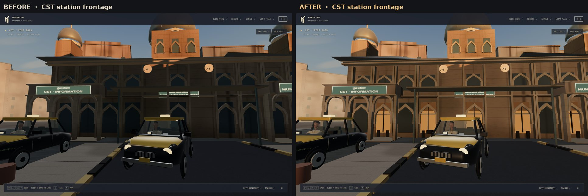
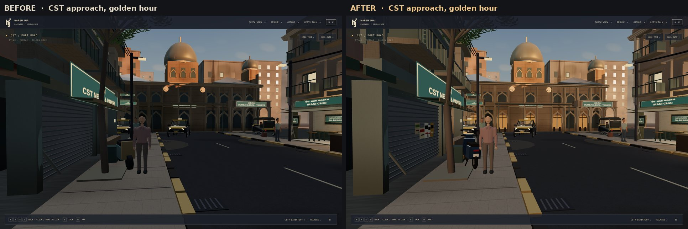
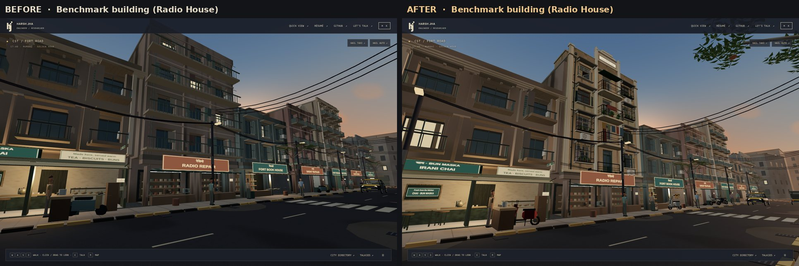
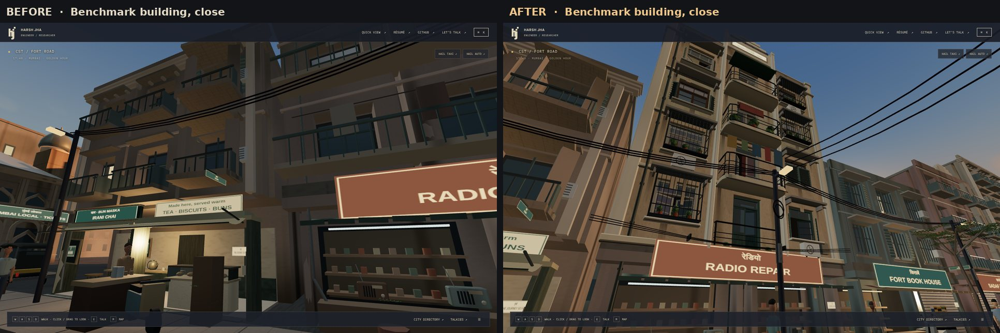
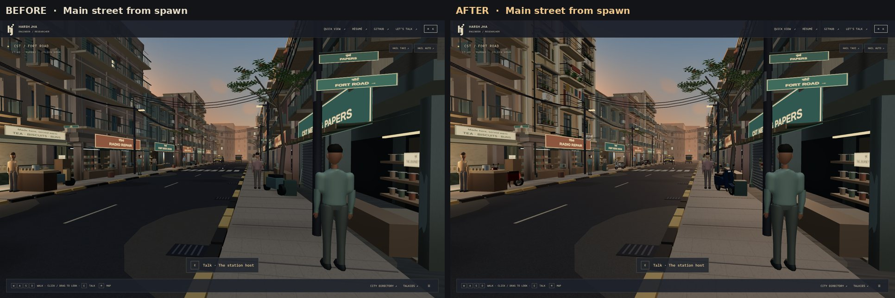
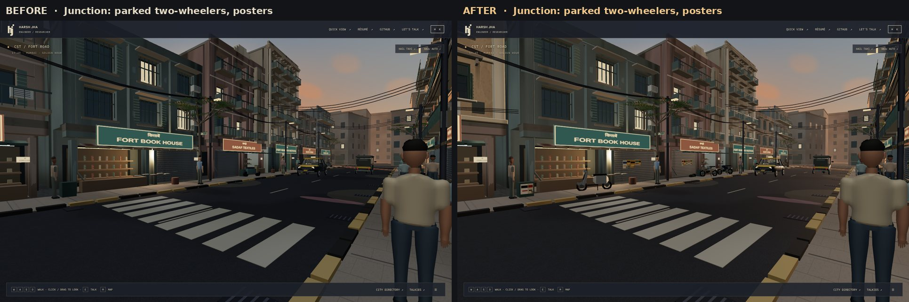
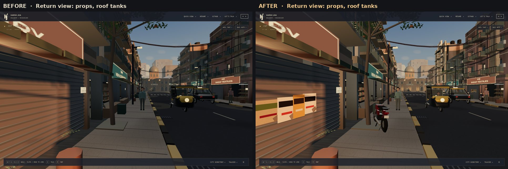

# Street realism pass: CST lighting, benchmark façade, street dressing

Branch `claude/mumbai-visual-overhaul-wsa2hm`, based on `feature/cst-fort-rendering-optimization` at `9fd9743`. This covers priorities 2–4 of the realism spec. Characters (priority 1) are handled in a separate thread.

The verdicts below come from matched before/after captures: Chromium with SwiftShader, 1440×900, the Medium preset, reduced motion and review poses. The baseline came from a worktree of `9fd9743` captured with the same poses. Passing tests were not used to judge how the scene looks.

## Visual review

### CST station (priority 2): done

**Why it was dark.** The low north-western sun comes down the street axis, so the street's west-side blocks put the station frontage in their shadow. The only fill was a cool, weak hemisphere light. Arches, piers and doors merged into one brown mass.

**What changed.**
- **Street bounce.** A warm, unshadowed directional light comes from the north-east (`STREET_MOOD.bounce*`, intensity 1.15 against the 4.4 sun). It stands in for light thrown back by the sunlit street. It reaches surfaces facing away from the sun (the station front and east-facing façades), while sunlit tops stay clearly brighter, so the shade still reads as shade.
- **Lit booking hall.** The central and wing doorways now show a warm, lit concourse, with a darker transom band, door frames and silhouettes. Lamps hang under each arcade arch.
- **Lighter stone ageing.** Station materials take weathering 0.4 instead of the stone default of 0.85, so carving and arches are not lost under procedural grime.
- **Matte upper windows.** The upper windows lost their glossy glass finish, which flashed white under the new bounce light.

**Result.** The arches, piers, clocks and entrances are readable from the forecourt and from the street. The domes and towers still catch the orange sun above a cooler shaded base, so it still reads as golden hour. The whole scene is not uniformly brightened: the street's shaded side is still darker than its sunlit upper storeys.

Foreground pedestrians facing the camera near the station are lit by the same bounce, so they are no longer silhouettes.

### Benchmark building: Radio House, above RADIO REPAIR (priority 3): done, code-authored

| Wide | Close |
|---|---|
|  |  |

The building at street index -1:1 is the most prominent façade in the spawn and junction views. Its procedural chawl storeys were replaced with an authored 1930s Bombay Deco walk-up (`architecture/BenchmarkFacade.ts`). It has:

- **Real openings.** The wall is built from piers, spandrels and lintels around each window and balcony door, with 0.3 m reveals and dim rooms behind, some with drawn curtains.
- **Windows.** Timber frames with transoms, fanlights with glazing bars, and two-leaf casements set at varied angles.
- **Shutters and grilles.** Louvred shutters that are open against the wall, half-swung or closed. Projecting Mumbai box grilles with planter shelves, pots and tulsi.
- **Balconies.** A rounded Deco balcony per floor, with a chamfered slab, a top rail, speed-line rails and posts. The first floor has a shallow French balcony so it clears the shop board. Each household uses its balcony differently: plants, a plastic chair, a washing line, a mattress over the rail, a tarpaulin.
- **Mouldings.** Moulded sills with drip grooves, sloping concrete chajjas on brackets, chamfered floor bands with shadow grooves, corner pilasters, and Deco fins rising into a stepped parapet crown with a name plaque.
- **Services.** A rainwater pipe with hopper, brackets and shoe. Split AC units with brackets, refrigerant pipe and drip stains. A sagging cable bundle with clamps, and a meter box.
- **Roof.** Black Sintex tanks on angle-iron stands, a stair head-room with a door, and a TV mast.
- **Weathering.** A repainted storey, run-off streaks under every sill, chajja end, AC unit, balcony and the parapet coping, and per-part colour jitter.
- **Baked occlusion.** Undersides, reveal depth and contact with the wall are darkened in the vertex colour.

**Honest limits.** Everything is code-authored geometry with vertex colour on the shared 384×256 procedural atlas. It is not a Blender/Substance asset with trim sheets and baked maps.

- Up close, surfaces are still flat colour with the world-space weathering on top. There is no real brick or plaster normal detail and no decals.
- Under a 0.1 m scale it still reads as "very good procedural", not photographic.
- It is the right silhouette and depth benchmark. Material fidelity still needs the authored assets in the transformation plan (P2/P3).

### Main street and dressing (priority 4): partly done

| Spawn | Junction | Return |
|---|---|---|
|  |  |  |

**Done:**
- **Parked two-wheelers.** Nine scooters (Activa-style) and commuter motorcycles, parked on their stands and angled to the kerb. Each has a body shell, legshield, seat, handlebar, mirrors, headlamp, tail lamp, number plate, tyres and hubs. They replace six six-box placeholders.
- **Posters.** Layered, torn posters pasted on junction boxes and on closed shop shutters.
- **Cables, rubbish and roof tanks.** Coils of spare cable on alternate poles. Refuse bags and a flattened carton beside street furniture. Black Sintex roof tanks on the front roofs seen down the street.

**Partial:**
- **Posters.** They are colour-block layouts with no typography. Real poster art needs a texture, and the texture budget has no headroom.
- **Drains, kerbs and markings.** These were already present and are unchanged.
- **Shop displays and vegetation.** Also unchanged.

## Performance

Static review budget (Medium, cached shadows): 110 draws, 230,000 submitted triangles, 32 textures, 26 programs. **No budget was raised.**

| Pose | Before draws / tris | After draws / tris |
|---|---|---|
| spawn | 73 / 196,273 | 79 / 210,179 |
| station | 65 / 181,087 | 66 / 176,859 |
| junction | 62 / 185,554 | 69 / 201,130 |
| shops | 62 / 184,442 | 66 / 190,854 |
| hero-wide | 32 / 160,367 | 37 / 171,153 |
| return (peak) | 97 / 208,637 | 102 / 214,035 |
| fort / fort-room | 28 / 145,428 · 27 / 139,356 | 30 / 144,112 · 28 / 136,370 |
| north-limit | 11 / 91,392 | 11 / 86,440 |

- Textures stay at 27–32 and programs at 26 in every view.
- The new geometry reuses the café's material path, so it adds **no textures and no shader programs**. `BakedKit` shares the `hero-finish-v1` program and the one atlas texture.
- The bounce light changes the light count uniformly for every material. The program count is unchanged.

Continuous software benchmark (`scripts/benchmark-gpu.mjs`, SwiftShader, 1920×1080, short labelled rides, fixed quality), maximum cached-frame submissions:

| Scenario | Before tris / draws | After tris / draws |
|---|---|---|
| walking | 200,249 / 78 | 214,155 / 84 |
| taxi ride | 214,849 / 88 | 220,455 / 93 |
| auto ride | 223,917 / 101 | 226,969 / 107 |
| fort | 145,428 / 28 | 144,112 / 30 |

**Frame time.** SwiftShader frame intervals are seconds long and noisy. They are only comparable as a ratio: walking p50 went from 5.20 s to 5.53 s (+6%) and the taxi ride from 6.23 s to 6.65 s (+7%).

This is a software CPU rasteriser at 1920×1080, not a GPU figure. A hardware laptop measurement per `docs/GPU_BENCHMARK.md` is still needed before any budget rebase.

**How it stays in budget.**
- **Near-detail LOD.** The benchmark's fine parts (casement sashes, grille bars, railings, plants, cables, slats) are a separate batch. It draws only within 22 m and only on foot, and it casts no shadow, so toggling it never invalidates the cached shadow map.
- **Prop batches by street third.** Props are baked into three batches, one per third of the street, each frustum-culled and hidden beyond 30 m along the street.
- **Cheap chamfers.** Bevels use a 28-triangle chamfered extrusion instead of a 108-triangle `RoundedBoxGeometry`.
- **Removed geometry.** The benchmark replaces the old procedural upper storeys, roof drum and dish of that frontage rather than adding to them.

**First iteration (recorded honestly).** Before these measures, the ride frames reached 237k (taxi) and 247k (auto) triangles. They were brought under the ceiling before this branch was proposed.

## Tests and build

- `npx tsc --noEmit`: clean.
- `npx vitest run`: 86 tests pass, including 5 new ones in `tests/benchmark-facade.test.ts`:
  - shared program and atlas
  - triangle allowance
  - pavement clearance
  - baked occlusion direction
  - two-wheeler size and cost
  - bounce direction and strength
- `npm run build`: succeeds. The chunk-size warning is pre-existing.
- Browser suite (`playwright.cloud.config.ts`): see the PR description for this run's result.

## Requirement status

| Requirement | Status |
|---|---|
| CST readable under cinematic lighting, sunset kept, not uniformly bright | **Done** |
| Foreground pedestrians not unnaturally dark near the station | **Done** (bounce fill) |
| Shops and interiors inviting | **Done** for the station concourse. Street shops unchanged. |
| One prominent façade rebuilt as the benchmark | **Done**, code-authored geometry (see limits) |
| Bevels, windows, doors, balconies, railings, shutters, signage, weathering, AO | **Done** in geometry and vertex colour. No texture-level material detail. |
| Prefer well-authored modular GLB components | **BLOCKED.** External asset sources (Sketchfab, Poly Haven, ambientCG, Blender add-on sites) are refused by this environment's network proxy, and no artist-authored GLBs are in the repository. Needs a Blender/Substance kit per `TRANSFORMATION_PLAN.md`, delivered through the existing GLB admission path. |
| Parked scooters and motorcycles | **Done** (code-authored) |
| Wires and poles | **Partial** (cable coils added; network unchanged) |
| Signs and posters | **Partial** (posters without typography) |
| Shop displays, drains, kerbs, markings, vegetation | **Not changed in this pass** |
| Rooftop AC units and water tanks | **Done** on the benchmark and front roofs |
| Movement, NPCs, rides, destinations, exhibition, Quick View, mobile, accessibility, adaptive quality preserved | **Done**: unit tests pass, plus the browser suite result in the PR. Mobile and shadowless use the existing balance with the bounce scaled by 0.7. |
| Budgets measured, not raised | **Done** |
